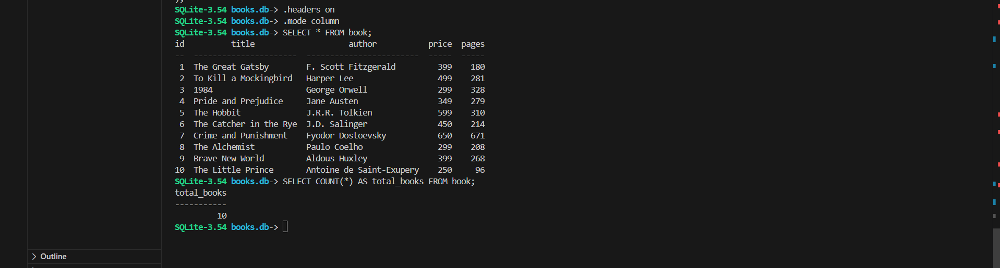
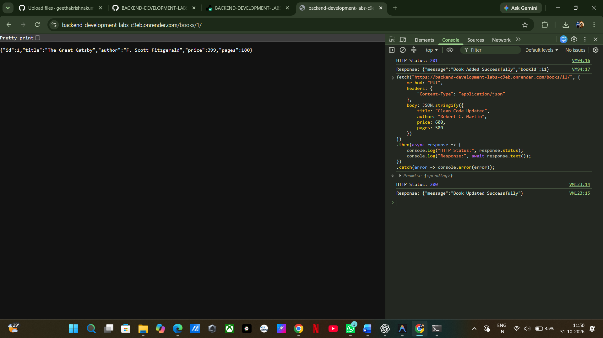
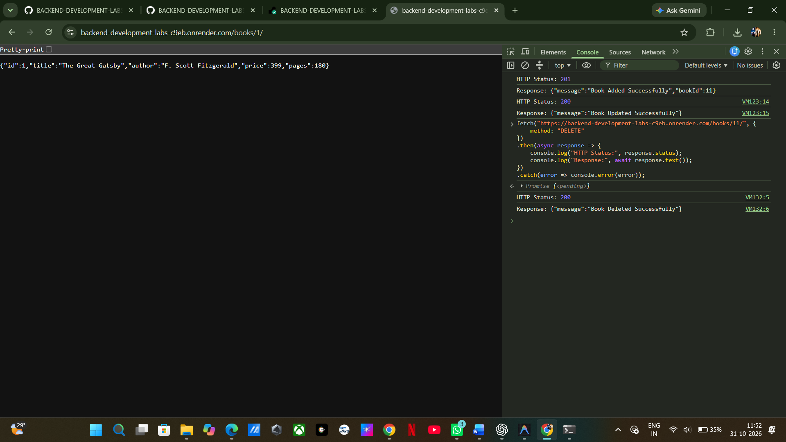

# Lab 2: SQLite Database and CRUD Routes

**Course:** Backend Development Fundamentals
**Year:** II
**Term:** II
**Week:** 2 (Slots 6–12)
**Module:** SQLite and Relational Database Operations
**Faculty:** Joel Prashanth D

---

## 1. Student Details

| Field               | Details                         |
| ------------------- | ------------------------------- |
| Name                | KUMBHA GEETHA KRISHNA           |
| Registration Number | 252U1R9080                      |
| Section             | CSE GEN-AI                      |
| Lab Number          | 02                              |
| Lab Title           | SQLite Database and CRUD Routes |

---

## 2. Live Deployment Link

**Live URL:** Not deployed yet (Local demonstration).

The application is currently configured and tested locally using Node.js, Express.js and SQLite.

SQLite uses a local database file (`books.db`). Persistent cloud deployment requires appropriate persistent storage configuration.

All API endpoints can be demonstrated locally using Postman.

---

## 3. Objective

The objective of this lab is to connect an Express.js server to an SQLite database and implement CRUD (Create, Read, Update and Delete) operations through REST API endpoints.

The application provides a Book Management API that allows users to retrieve, add, update and delete book records stored in an SQLite database.

---

## 4. Technologies Used

| Technology   | Purpose                                              |
| ------------ | ---------------------------------------------------- |
| Node.js      | JavaScript runtime environment                       |
| Express.js   | Backend web framework                                |
| SQLite       | Relational database                                  |
| sqlite       | Promise-based SQLite interface                       |
| sqlite3      | SQLite database driver                               |
| Nodemon      | Automatically restarts the server during development |
| Postman      | API testing tool                                     |
| Git & GitHub | Version control and project submission               |

---

## 5. Project Structure

```text
lab-02/
│
├── database/
│   ├── books.db
│   └── schema.sql
│
├── screenshots/
│   ├── sqlite-database.png
│   ├── get-all-books.png
│   ├── get-single-book.png
│   ├── post-add-book.png
│   ├── put-update-book.png
│   ├── delete-book.png
│   └── not-found.png
│
├── server.js
├── verify-endpoints.js
├── package.json
├── package-lock.json
├── .gitignore
└── README.md
```

---

## 6. Database Design

The application uses an SQLite database named `books.db`.

**Database Table:** `book`

### Table Schema

```sql
CREATE TABLE IF NOT EXISTS book (
    id INTEGER PRIMARY KEY,
    title TEXT,
    author TEXT,
    price INTEGER,
    pages INTEGER
);
```

### Column Description

| Column | Data Type | Description                     |
| ------ | --------- | ------------------------------- |
| id     | INTEGER   | Unique identifier for each book |
| title  | TEXT      | Name of the book                |
| author | TEXT      | Author of the book              |
| price  | INTEGER   | Price of the book               |
| pages  | INTEGER   | Number of pages                 |

The database was initially populated with 10 sample book records using the SQLite Command Line Interface (CLI).

### Initial Database Records

| ID | Book Title             | Author                   | Price | Pages |
| -- | ---------------------- | ------------------------ | ----: | ----: |
| 1  | The Great Gatsby       | F. Scott Fitzgerald      |   399 |   180 |
| 2  | To Kill a Mockingbird  | Harper Lee               |   499 |   281 |
| 3  | 1984                   | George Orwell            |   299 |   328 |
| 4  | Pride and Prejudice    | Jane Austen              |   349 |   279 |
| 5  | The Hobbit             | J.R.R. Tolkien           |   599 |   310 |
| 6  | The Catcher in the Rye | J.D. Salinger            |   450 |   214 |
| 7  | Crime and Punishment   | Fyodor Dostoevsky        |   650 |   671 |
| 8  | The Alchemist          | Paulo Coelho             |   299 |   208 |
| 9  | Brave New World        | Aldous Huxley            |   399 |   268 |
| 10 | The Little Prince      | Antoine de Saint-Exupery |   250 |    96 |

### SQLite CLI Commands

Open the database:

```bash
sqlite3 database/books.db
```

View available tables:

```sql
.tables
```

View the table structure:

```sql
.schema book
```

Retrieve all records:

```sql
SELECT * FROM book;
```

Count the records:

```sql
SELECT COUNT(*) FROM book;
```

Exit SQLite:

```sql
.exit
```

---

## 7. Installation and Setup

### Prerequisites

Make sure the following software is installed:

* Node.js
* npm
* SQLite Command Line Tools
* Postman

### Step 1: Clone the Repository

```bash
git clone https://github.com/geethakrishnakumbha/BACKEND-DEVELOPMENT-LABS.git
```

### Step 2: Navigate to Lab 2

```bash
cd BACKEND-DEVELOPMENT-LABS/lab-02
```

### Step 3: Install Dependencies

```bash
npm install
```

### Step 4: Start the Development Server

```bash
npm run dev
```

Nodemon automatically restarts the server whenever changes are made to the source code.

The application runs at:

`http://localhost:3000/`

### Step 5: Run Automated Tests

```bash
npm test
```

The automated test suite verifies the CRUD endpoints, input validation, error handling and database modifications.

### Environment Variables

No additional environment variables are required for the current local implementation.

The server uses port `3000`.

---

## 8. API Endpoints

The application implements five CRUD endpoints.

| HTTP Method | Endpoint          | Description                              | Status Code |
| ----------- | ----------------- | ---------------------------------------- | ----------- |
| GET         | `/books/`         | Retrieves all books                      | 200 OK      |
| GET         | `/books/:bookId/` | Retrieves a particular book using its ID | 200 OK      |
| POST        | `/books/`         | Adds a new book                          | 201 Created |
| PUT         | `/books/:bookId/` | Updates an existing book                 | 200 OK      |
| DELETE      | `/books/:bookId/` | Deletes a particular book                | 200 OK      |

### 8.1 GET All Books

**Endpoint:**

```http
GET /books/
```

**Description:**

Retrieves all book records stored in the SQLite database.

**Example URL:**

```text
http://localhost:3000/books/
```

**Expected Status:** `200 OK`

### 8.2 GET Book by ID

**Endpoint:**

```http
GET /books/:bookId/
```

**Description:**

Retrieves a specific book using its unique ID.

**Example URL:**

```text
http://localhost:3000/books/1/
```

**Expected Status:** `200 OK`

If the requested book does not exist, the API returns `404 Not Found`.

### 8.3 POST - Add a New Book

**Endpoint:**

```http
POST /books/
```

**Description:**

Adds a new book record to the SQLite database.

**Request Body:**

```json
{
    "title": "Clean Code",
    "author": "Robert C. Martin",
    "price": 550,
    "pages": 464
}
```

**Expected Status:** `201 Created`

### 8.4 PUT - Update an Existing Book

**Endpoint:**

```http
PUT /books/:bookId/
```

**Description:**

Updates the details of an existing book using its ID.

**Example URL:**

```text
http://localhost:3000/books/11/
```

**Request Body:**

```json
{
    "title": "Clean Code Updated",
    "author": "Robert C. Martin",
    "price": 600,
    "pages": 500
}
```

**Expected Status:** `200 OK`

If the requested book does not exist, the API returns `404 Not Found`.

### 8.5 DELETE - Remove a Book

**Endpoint:**

```http
DELETE /books/:bookId/
```

**Description:**

Deletes an existing book record from the SQLite database.

**Example URL:**

```text
http://localhost:3000/books/11/
```

**Expected Status:** `200 OK`

If the requested book does not exist, the API returns `404 Not Found`.

---

## 9. SQL Injection Prevention

Parameterized SQL queries are used throughout the application to prevent SQL injection.

Instead of directly inserting user input into SQL statements, the application uses `?` placeholders.

**Example:**

```javascript
const getBookQuery = `
    SELECT *
    FROM book
    WHERE id = ?;
`;

const book = await db.get(getBookQuery, bookId);
```

This ensures that user input is treated as data rather than executable SQL instructions.

---

## 10. Database Connection and Server Initialization

The application uses an asynchronous function named:

```javascript
initializeDBAndServer()
```

This function:

1. Opens the SQLite database.
2. Waits for the database connection to succeed.
3. Starts the Express server only after a successful connection.
4. Handles database initialization errors.

The application uses `async/await` to handle asynchronous database operations.

---

## 11. API Testing and Verification

The API endpoints were tested using Postman and an automated test suite.

The automated tests verify:

* Successful retrieval of all books.
* Successful retrieval of a single book.
* Addition of new book records.
* Updating existing book records.
* Deletion of book records.
* Invalid input handling.
* Non-existent book ID handling.
* Database changes after POST, PUT and DELETE operations.

### Automated Testing

Run:

```bash
npm test
```

The implementation report recorded 21 passing tests.

### Database Verification

The SQLite CLI was used to verify that:

* Initially, 10 book records existed.
* POST increased the record count to 11.
* PUT successfully modified the inserted record.
* DELETE removed the inserted record.
* The final record count returned to 10.

---

## 12. Screenshots

### 12.1 SQLite Database

Displays the SQLite database and initial book records.



### 12.2 GET All Books

Displays all available book records.


### 12.3 GET Single Book

Displays the details of a particular book.


### 12.4 POST - Add Book

Displays the successful insertion of a new book.


### 12.5 PUT - Update Book

Displays the successful update of an existing book.



### 12.6 DELETE - Remove Book

Displays the successful deletion of a book.



### 12.7 Error Handling

Displays the 404 Not Found response for a non-existent book.


---

## 13. Problems Faced and Solutions

| Problem                                                         | Solution                                             |
| --------------------------------------------------------------- | ---------------------------------------------------- |
| Establishing the database connection before starting the server | Used async/await inside `initializeDBAndServer()`    |
| Preventing SQL injection                                        | Used parameterized queries with `?` placeholders     |
| Handling invalid book IDs                                       | Implemented 404 Not Found responses                  |
| Handling invalid request data                                   | Added input validation and 400 Bad Request responses |
| Automatically restarting the server                             | Configured Nodemon                                   |
| Verifying database modifications                                | Used SQLite CLI to inspect database records          |
| Testing multiple API operations                                 | Used Postman and automated endpoint tests            |

---

## 14. Viva Questions and Answers

**1. What is SQLite?**

SQLite is a lightweight relational database management system that stores data in a single database file.

**2. What is CRUD?**

CRUD stands for Create, Read, Update and Delete.

**3. Why do we use async/await?**

We use async/await to handle asynchronous operations and ensure that dependent operations execute only after the required operation completes.

**4. What is SQL Injection?**

SQL Injection is a security vulnerability in which malicious SQL commands are introduced through user input to manipulate database queries.

**5. How do placeholders prevent SQL Injection?**

Placeholders separate user-provided data from SQL instructions, preventing input from being interpreted as executable SQL code.

**6. What is the difference between POST and PUT?**

POST is generally used to create a new resource, whereas PUT is used to update or replace an existing resource.

**7. What is Nodemon?**

Nodemon is a development utility that automatically restarts the Node.js server whenever changes are detected in the source files.

**8. What is the difference between db.get() and db.all()?**

`db.get()` retrieves a single matching record, whereas `db.all()` retrieves all matching records.

**9. Why is db.run() used?**

`db.run()` is used to execute SQL statements such as INSERT, UPDATE and DELETE.

**10. What is a primary key?**

A primary key uniquely identifies each record in a database table.

**11. What is the purpose of express.json()?**

It is Express middleware that parses incoming JSON request bodies and makes the parsed data available through `request.body`.

**12. Why do we check result.changes?**

It helps determine whether an UPDATE or DELETE operation actually affected any database records.

---

## 15. Conclusion

Successfully implemented a Book Management REST API using Node.js, Express.js and SQLite.

The application supports all five CRUD operations through HTTP endpoints and uses parameterized SQL queries to prevent SQL injection.

The database connection is established asynchronously before the server starts.

The application was tested using Postman and automated tests, and database modifications were verified using the SQLite Command Line Interface.

This lab provided practical experience in relational database operations, backend development, REST API implementation and database integration.

---

## 16. Submission Checklist

* [x] Node.js and Express server implemented.
* [x] SQLite database created.
* [x] Book table created.
* [x] 10 initial book records inserted.
* [x] Database initialization implemented using async/await.
* [x] All five CRUD endpoints implemented.
* [x] Parameterized SQL queries used.
* [x] Input validation and error handling implemented.
* [x] Nodemon configured.
* [x] Automated tests executed.
* [ ] Postman screenshots added to screenshots/.
* [ ] Final README screenshot references verified.
* [ ] Changes committed and pushed to GitHub.
* [ ] Live deployment completed or deployment limitation documented.

**GitHub Repository:**
https://github.com/geethakrishnakumbha/BACKEND-DEVELOPMENT-LABS
