# Lab 3: REST API, Query Parameters, Validation & Debugging

**Name:** Kumbha Geetha Krishna
**Registration Number:** 252U1R9080
**Section:** CSE GEN-AI
**Course:** Backend Development Fundamentals
**Lab Number:** 03

---

## 1. Live Deployment

**Platform:** Render

**Live API URL:**
https://backend-development-labs-1-ho2i.onrender.com/

The Book Management REST API is deployed and publicly accessible through Render.

---

## 2. Objective

The objective of this lab is to extend the existing Lab 2 Book Management API into a RESTful API with additional functionalities, including:

* Search books using query parameters.
* Sort books using ascending and descending order.
* Implement pagination using limit and offset.
* Filter books based on minimum and maximum prices.
* Validate incoming POST and PUT requests.
* Implement appropriate HTTP status codes.
* Maintain consistent JSON response formats.
* Identify and debug common backend development errors.

---

## 3. Technologies Used

* **Node.js:** JavaScript runtime environment.
* **Express.js:** Backend web framework.
* **SQLite:** Relational database.
* **JavaScript:** Server-side programming language.
* **Postman Web:** API testing.
* **Render:** Cloud deployment platform.
* **GitHub:** Version control and project submission.

---

## 4. Project Structure

```text
lab-03/
│
├── database/
│   ├── books.db
│   └── schema.sql
│
├── screenshots/
│   ├── 01-api-welcome.png
│   ├── 02-get-all-books.png
│   ├── 03-search-books.png
│   ├── 04-ascending-sort.png
│   ├── 05-descending-sort.png
│   ├── 06-pagination.png
│   ├── 07-price-range-filter.png
│   ├── 08-create-book.png
│   ├── 09-validation-error.png
│   ├── 10-update-book.png
│   ├── 11-delete-book.png
│   ├── 12-book-not-found.png
│   └── 13-database-view.png
│
├── .gitignore
├── package.json
├── package-lock.json
├── README.md
├── server.js
└── verify-endpoints.js
```

---

## 5. Installation and Execution

### Prerequisites

* Node.js 18 or later
* npm
* Visual Studio Code
* Internet connection

### Step 1: Clone the repository

```bash
git clone https://github.com/geethakrishnakumbha/BACKEND-DEVELOPMENT-LABS.git
```

### Step 2: Navigate to Lab 3

```bash
cd BACKEND-DEVELOPMENT-LABS/lab-03
```

### Step 3: Install dependencies

```bash
npm install
```

### Step 4: Start the server

```bash
npm start
```

The server starts on port 3000 by default.

The application also supports the PORT environment variable provided by hosting platforms such as Render.

### Step 5: Run automated tests

Open another terminal and execute:

```bash
npm test
```

The automated test script verifies the main API functionalities and validation cases.

---

## 6. Environment Variables

| Variable | Description              | Default           |
| -------- | ------------------------ | ----------------- |
| PORT     | Server port              | 3000              |
| DB_PATH  | SQLite database location | database/books.db |

No additional environment variables are required for the default local setup.

Do not commit `.env` files or sensitive information to GitHub.

---

## 7. API Endpoints

The following REST API endpoints are implemented.

| HTTP Method | Endpoint         | Description                                                    |
| ----------- | ---------------- | -------------------------------------------------------------- |
| GET         | `/`              | Returns API welcome message                                    |
| GET         | `/books`         | Retrieves books with search, sorting, pagination and filtering |
| GET         | `/books/:bookId` | Retrieves a specific book                                      |
| POST        | `/books`         | Adds a new book                                                |
| PUT         | `/books/:bookId` | Updates an existing book                                       |
| DELETE      | `/books/:bookId` | Deletes a book                                                 |

### 7.1 Query Parameters

The GET `/books` endpoint supports the following query parameters.

| Parameter | Default Value | Description                                       |
| --------- | ------------- | ------------------------------------------------- |
| search_q  | Empty         | Searches books using partial title matching       |
| order_by  | id            | Specifies the sorting column                      |
| order     | ASC           | Specifies ascending or descending order           |
| limit     | 10            | Specifies the maximum number of records           |
| offset    | 0             | Specifies the number of records to skip           |
| min_price | Not applied   | Filters books above or equal to the minimum price |
| max_price | Not applied   | Filters books below or equal to the maximum price |

Supported sorting columns:

* id
* title
* author
* price
* pages

Supported sorting directions:

* ASC
* DESC

### Example Request

```http
GET /books?search_q=The&order_by=price&order=ASC&limit=5&offset=0&min_price=200&max_price=600
```

This request searches for books containing the word "The", filters prices between 200 and 600, sorts the results in ascending order and returns a maximum of five records.

---

## 8. Request Validation

The API validates incoming POST and PUT requests.

The following fields are required:

| Field  | Validation                           |
| ------ | ------------------------------------ |
| title  | Must be a non-empty string           |
| author | Must be a non-empty string           |
| price  | Must be a non-negative numeric value |
| pages  | Must be a positive integer           |

### Example POST Request

```json
{
  "title": "Introduction to Node.js",
  "author": "Geetha Krishna",
  "price": 450,
  "pages": 250
}
```

Successful creation returns:

`201 Created`

### Example Invalid Request

```json
{
  "author": "Test Author",
  "price": "invalid",
  "pages": 100
}
```

Expected response:

`400 Bad Request`

The API returns a descriptive JSON error message.

---

## 9. HTTP Status Codes

The API uses appropriate HTTP status codes.

| Status Code | Meaning               | Usage                                     |
| ----------- | --------------------- | ----------------------------------------- |
| 200         | OK                    | Successful GET, PUT and DELETE            |
| 201         | Created               | Successful POST                           |
| 400         | Bad Request           | Invalid input or query parameters         |
| 404         | Not Found             | Requested book or endpoint does not exist |
| 500         | Internal Server Error | Unexpected server-side error              |

### Consistent JSON Error Response

Example:

```json
{
  "message": "Book not found."
}
```

All API error responses use a consistent JSON message structure.

---

## 10. API Testing Using Postman Web

The deployed API is tested using Postman Web.

**Base URL:**

```text
https://backend-development-labs-1-ho2i.onrender.com
```

### Test Cases

| No. | Test Case                | Method | Expected Result |
| --- | ------------------------ | ------ | --------------- |
| 1   | API welcome message      | GET    | 200             |
| 2   | Retrieve all books       | GET    | 200             |
| 3   | Search books             | GET    | 200             |
| 4   | Ascending price sorting  | GET    | 200             |
| 5   | Descending price sorting | GET    | 200             |
| 6   | Pagination               | GET    | 200             |
| 7   | Price range filtering    | GET    | 200             |
| 8   | Create a book            | POST   | 201             |
| 9   | Invalid book details     | POST   | 400             |
| 10  | Update a book            | PUT    | 200             |
| 11  | Delete a book            | DELETE | 200             |
| 12  | Retrieve a missing book  | GET    | 404             |

---

## 11. Automated Testing Results

The project includes an automated testing script named `verify-endpoints.js`.

Run the following command:

```bash
npm test
```

### Test Results

The following nine automated checks were successfully completed:

| No. | Test Case                    | Result |
| --- | ---------------------------- | ------ |
| 1   | Health route                 | PASS   |
| 2   | List with pagination         | PASS   |
| 3   | Title search                 | PASS   |
| 4   | Price descending sort        | PASS   |
| 5   | Price range filter           | PASS   |
| 6   | Invalid sort column rejected | PASS   |
| 7   | Invalid limit rejected       | PASS   |
| 8   | Invalid POST body rejected   | PASS   |
| 9   | Missing book returns 404     | PASS   |

**Overall Result: 9/9 Tests Passed (100%).**

---

## 12. Screenshots

The following screenshots demonstrate the working API, successful operations and validation responses.

### 12.1 API Welcome Message

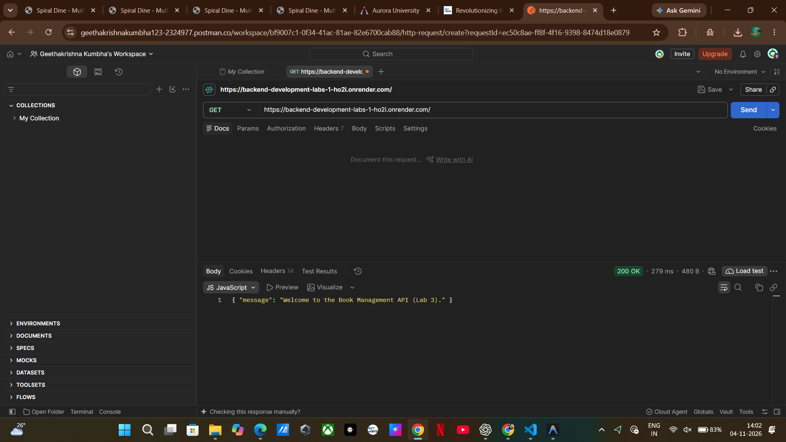

### 12.2 Retrieve All Books

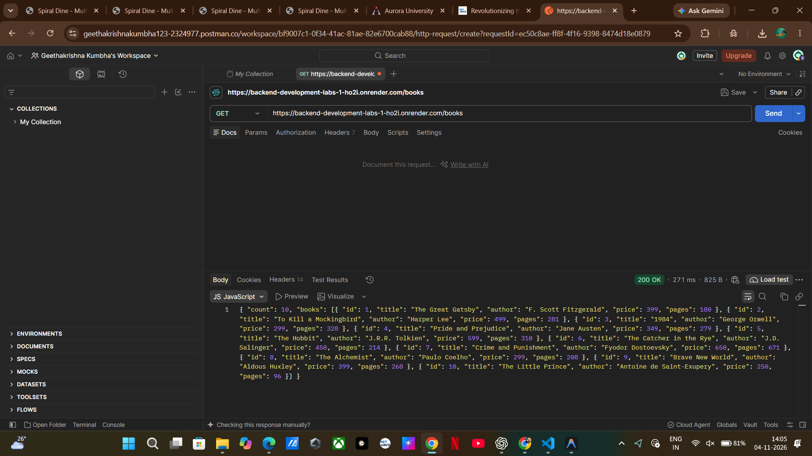

### 12.3 Search Books

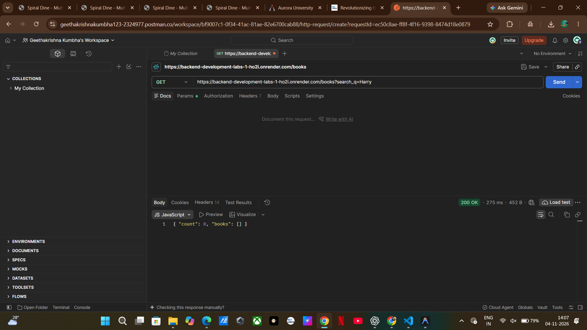

### 12.4 Ascending Price Sorting

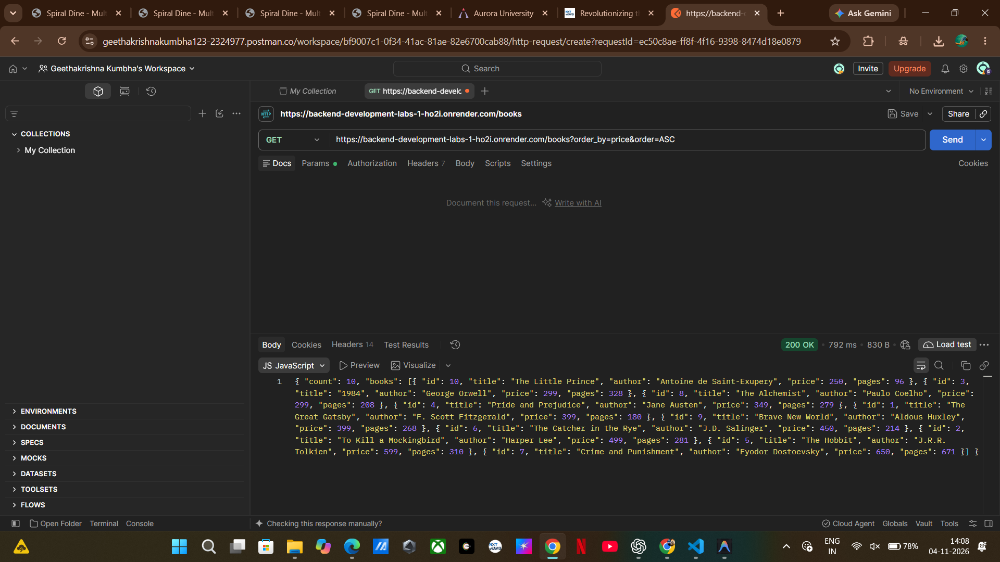

### 12.5 Descending Price Sorting

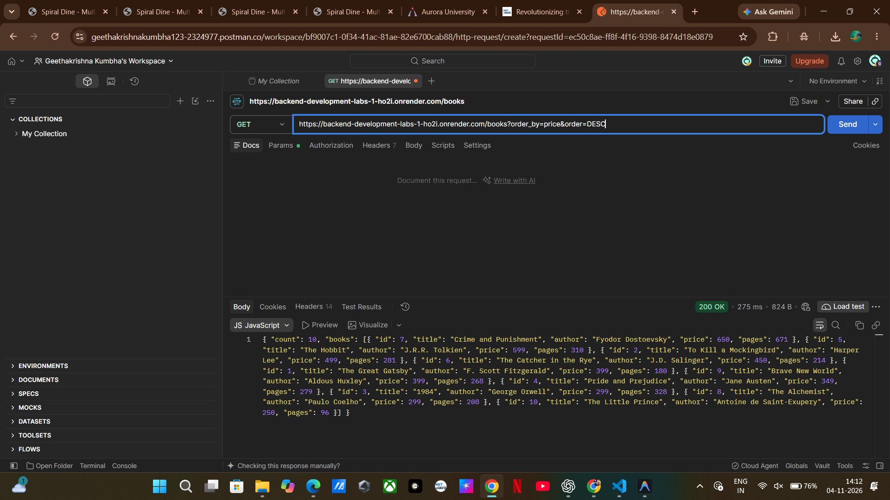

### 12.6 Pagination

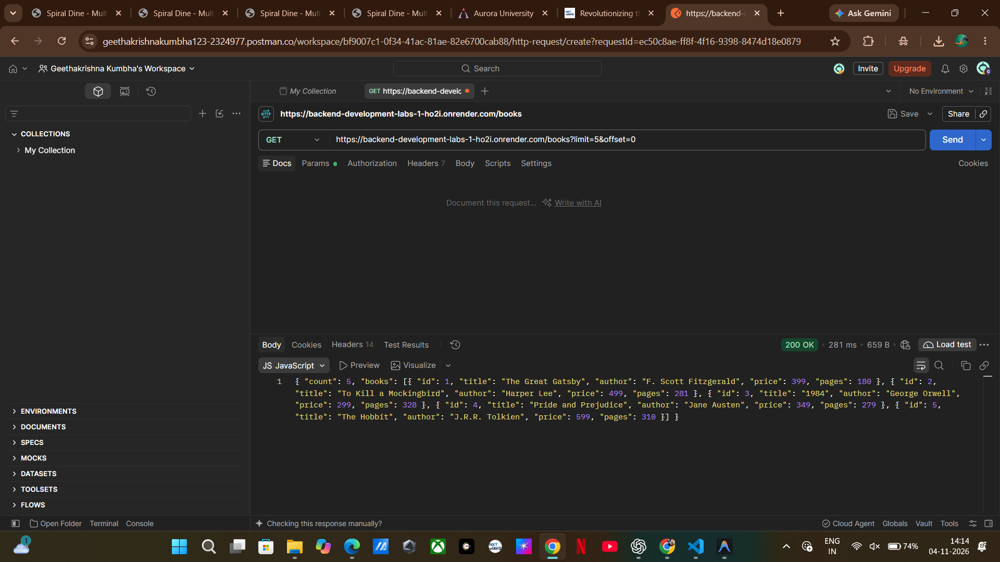

### 12.7 Price Range Filtering

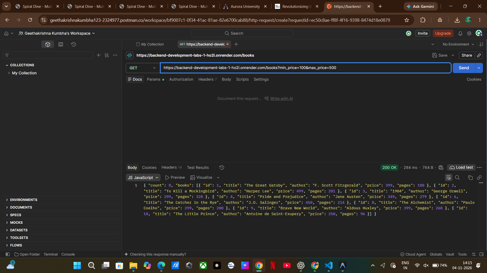

### 12.8 Create a New Book

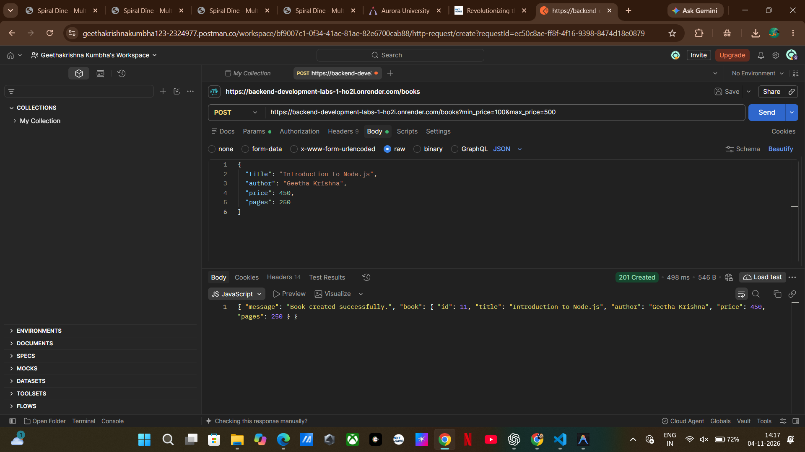

### 12.9 Input Validation Error

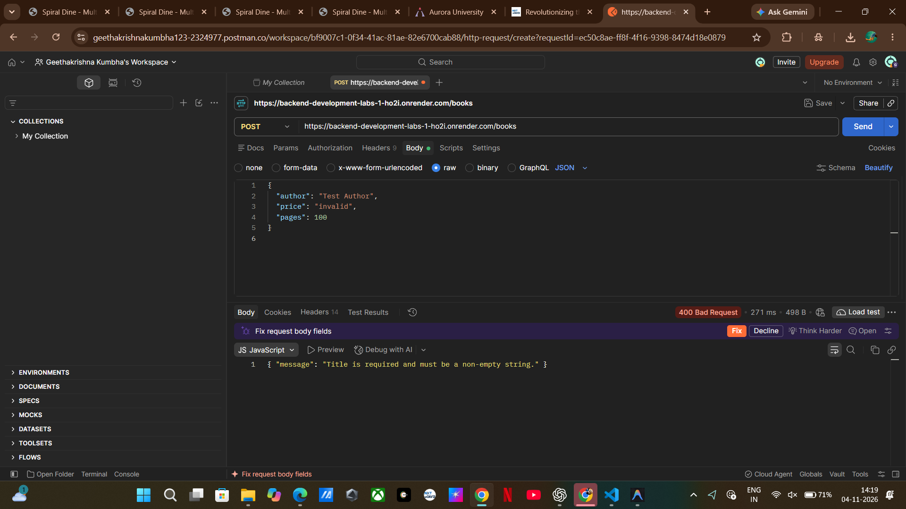

### 12.10 Update an Existing Book


### 12.11 Delete a Book

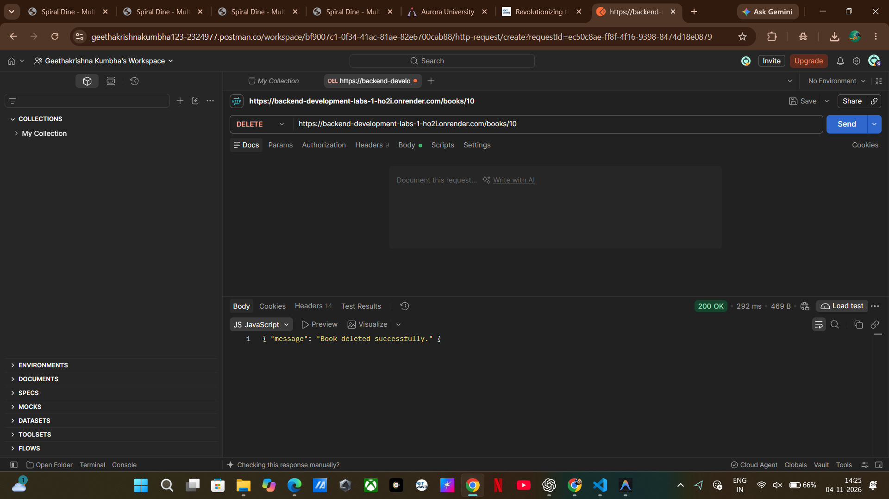

### 12.12 Book Not Found

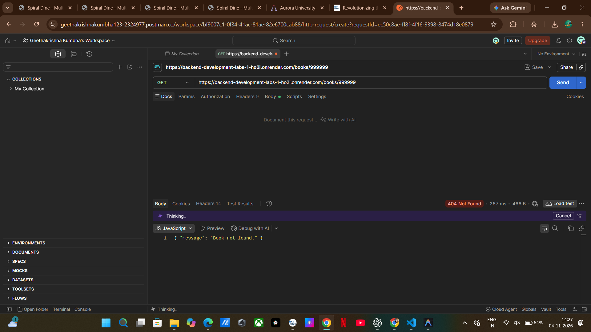

### 12.13 SQLite Database

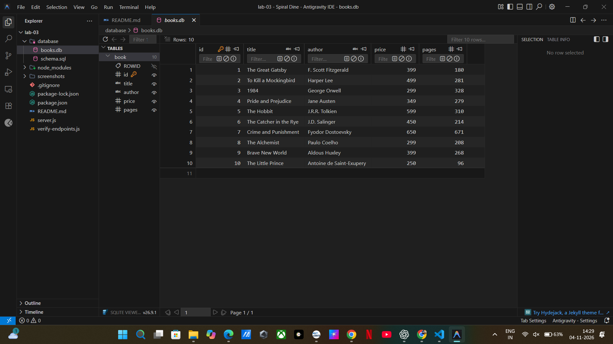

---

## 13. Debugging Exercises

The following common backend development errors were studied as part of this lab.

### 1. EADDRINUSE – Port Already in Use

**Problem:** Another process is already using the specified port.

**Solution:** Stop the existing server process or use another port.

Example:

```powershell
$env:PORT=3001
npm start
```

### 2. Wrong Import Path

**Problem:** An incorrect file path can cause a MODULE_NOT_FOUND error.

**Solution:** Verify the file name, directory structure and relative import path.

### 3. No Such Table

**Problem:** SQLite returns an error when a query references a table that does not exist.

**Solution:** Check the database schema and use the correct table name.

This project uses the table name `book` rather than `books`.

### 4. Missing Await

**Problem:** Database operations are asynchronous. Using their results before completion can cause unexpected behaviour.

**Solution:** Use `await` with asynchronous database operations such as:

```javascript
const books = await db.all("SELECT * FROM book");
```

---

## 14. Security and Database Practices

The following practices are followed:

* Parameterized SQL queries are used to prevent SQL injection.
* User-provided sorting columns are validated using an allow-list.
* Request bodies are validated before database operations.
* Appropriate HTTP status codes are returned.
* Database operations use asynchronous handling.
* Sensitive configuration files are excluded from GitHub.
* `node_modules` is excluded using `.gitignore`.

**Deployment note:** Render free web services use an ephemeral filesystem. SQLite changes may be lost when the service restarts or redeploys. Persistent storage is required if database changes must survive those events.

---

## 15. Problems Faced and Solutions

| Problem                       | Solution                                      |
| ----------------------------- | --------------------------------------------- |
| Implementing query parameters | Used Express `req.query`                      |
| Searching partial book titles | Used SQLite `LIKE` with parameterized queries |
| Sorting records               | Used validated sorting columns and ASC/DESC   |
| Implementing pagination       | Used LIMIT and OFFSET                         |
| Filtering prices              | Used minimum and maximum price conditions     |
| Invalid input handling        | Implemented request validation                |
| Database errors               | Used proper asynchronous database handling    |
| Cloud deployment              | Deployed the API using Render                 |

---

## 16. Conclusion

In this lab, the existing Book Management API was extended with additional REST API functionalities.

Search, sorting, pagination, price filtering, input validation and appropriate HTTP status codes were implemented successfully.

The application was deployed using Render, and the automated testing script successfully passed all nine test cases.

This lab helped improve my understanding of RESTful API development, database integration, request validation, debugging and cloud deployment.

---

**End of Lab 3 Report**
